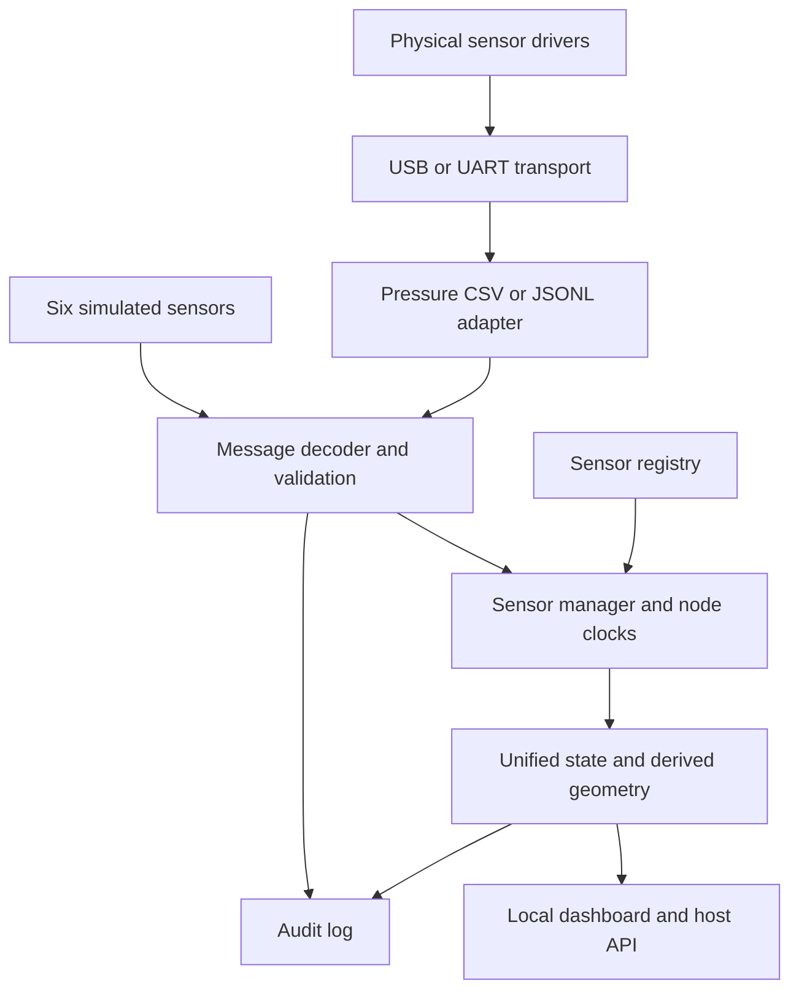

# K.E.V.I.N. — Sensor Integration Foundation

Version 0.4.0 · HAN Embedded Systems Engineering · 9 November 2026

**A working integration foundation and interactive patient-scenario lab for the infant training manikin.** Run it today with six simulated sensors. Tomorrow, replace the pressure simulation with the existing SAMD21 CSV stream, while keeping the same validation, state management, logs and dashboard.

This is educational equipment. Test signals, candidate pressure events and geometry are not clinically validated patient measurements. The system does not control a medical monitor or actuators.

## Start here: the big picture

Each module has one job. A **driver** gets a reading. An **adapter** turns it into the team's message format. The **manager** checks its identity, sequence, timing, calibration and validity. The **system state** contains current usable readings or `null` with a reason. Logs and the dashboard consume that state.



The current pressure firmware stays unchanged. The Pi owns the integration manager today. Future SAMD21 nodes acquire their own sensors; a future CAN gateway will reassemble/decode messages into the same interface. This does **not** assume every sensor attaches to CAN or the Pi.

**Liv owns:** the registry, message contract, adapters, manager, time policy, aggregate state and integration tests. Teammates own their sensor drivers and module calibration. See [ownership and teammate contract](docs/INTEGRATION_CONTRACT.md).

## 1. Run without hardware

Requires Python **3.10 or newer**. Simulation, replay, tests and the dashboard use the standard library. No package installation is needed for those modes.

1. Extract the ZIP.
2. Open a terminal in `KEVIN_Sensor_Integration`, the folder containing this README and `pyproject.toml`.
3. On Windows, create and use an environment:

   ```powershell
   py -3 -m venv .venv
   .\.venv\Scripts\python.exe -m kevin --mode simulate
   ```

   On Raspberry Pi OS or Linux:

   ```sh
   python3 -m venv .venv
   .venv/bin/python -m kevin --mode simulate
   ```

4. Open **http://127.0.0.1:8765** on the same computer.
5. **Interactive lab:** select a patient scenario (cardiac arrest — asystole/VF, respiratory arrest, pinched/blocked airway, bradycardia, hypoxia, normal or sensor-fault demo), adjust the **airway obstruction** slider and toggle **synthetic bag ventilation/chest compressions**. The patient panel shows an illustrative heartbeat trace, heart/respiratory rate, scenario oxygen target and a fictional airflow proxy. See [scenario documentation](docs/PATIENT_SCENARIOS.md) for how to interpret these demo-only displays. Separately, use each sensor checkbox to stop/restart its synthetic stream, then watch it become stale and disconnected. Move a manual-value slider to replace that sensor's automatically generated waveform (IMU sliders set a synthetic rotation about one axis), or use **Auto waveform** to return to automatic generation. The global controls can pause/resume *all* simulated streams, clear overrides, and switch between the normal and fault-demonstration timelines.
6. Press **Ctrl+C** in the terminal to stop. Logs are in `logs/session.jsonl`.

For subsequent examples, `python` means the environment's interpreter. You can activate it, or substitute the explicit Windows/Linux executable above. On minimal Pi OS, install Python and `python3-venv` through the OS package manager if they are missing.

```sh
python -m kevin --scenario demo
python -m kevin --disable spo2,temperature
python -m kevin --no-web --duration 10 --log logs/smoke.jsonl
```

Manual controls only change simulated inputs. They cannot control physical sensors, perform actual sensor calibration, or validate physiological thresholds. The dashboard is intentionally bound to localhost. It uses a per-process control token and should not be exposed through a public reverse proxy or network port. No source-data transformation on the dashboard can turn ADC counts into a measured volume or a calculated anatomical neck angle.

The patient-scenario presets and responses are non-clinical software fixtures, and the virtual ECG is decorative. Neither these values nor the pressure excursion from a pinched airway proves actual air delivery or CPR success. The repeating signal generators are software fixtures. The `demo` fault schedule runs once: delayed head messages at 3–4 s, SpO₂ silence at 4–11 s, and invalid pressure at 6–8 s, followed by recovery. Small seeded pressure noise is always present. Rejected delayed packets appear in diagnostics. No automatic physiological interpretation is performed.

## 2. Connect the existing pressure module tomorrow

Use the already verified Sensor A2 cable and configuration. Stop PlatformIO Serial Monitor/miniterm first: only one application can own the port.

```sh
python -m pip install -r requirements-serial.txt
python -m serial.tools.list_ports
```

Windows, physical pressure plus five simulations:

```powershell
python -m kevin --mode mixed --pressure-port COM3
```

Raspberry Pi:

```sh
python -m kevin --mode mixed --pressure-port /dev/ttyACM0
```

For **physical inputs only**, use `--mode physical`. Unconnected modules remain missing. No simulated values replace failed physical data.

```sh
python -m kevin --mode physical --pressure-port /dev/ttyACM0
```

The pressure card shows **delta in ADC counts**, not kPa. Raw ADC, baseline, candidate count, state and validity flags remain in each message's `meta` and the log. `baseline` calibration means only that the old firmware accepted a stable zero; it is not a physical pressure calibration.

A failed ADC read invalidates the baseline in the preserved firmware. Recovery requires the pressure to be at rest and manual `z` recalibration. The host does not automatically zero on reconnect. Stop the app, open a serial terminal at 115200 baud, send `z`, wait for `# READY`, close the terminal, then restart the app. Opening a port may reset some boards; observe the actual behavior. [Tomorrow's checklist](docs/TOMORROW_CHECKLIST.md) covers the full sequence.

Port permissions on Pi OS may require adding your user to the serial device's group (commonly `dialout`) and signing out/in. Prefer a stable `/dev/serial/by-id/...` path when available. The worker retries the configured path every second; it does not guess a different device after a port rename.

## 3. Replay saved pressure readings

```sh
python -m kevin --mode replay --pressure-file examples/pressure.csv
python -m kevin --mode replay --pressure-file firmware/pressure_legacy/data/pressure_20260922_145124.txt --speed 10
```

Replay preserves row intervals divided by `--speed`, flags and candidate counts. It is labelled **RECORDED REPLAY**. At end of file the last reading ages normally; it does not remain live forever. Accelerated replay is for analysis, not measuring real-time latency. Other channels remain missing.

## 4. Add protocol-compatible microcontrollers

```sh
python -m kevin --mode mixed --pressure-port COM3 --jsonl-port head_node=COM4
python -m kevin --mode physical --jsonl-port head_node=/dev/ttyACM1 --jsonl-port chest_node=/dev/ttyACM2
```

Each configured port has a separate reader, framing buffer and reconnect lifecycle. For the included **synthetic** SAMD21 example, use `--example-port head_node=COM4` instead of `--jsonl-port`; this explicitly enables its host-assigned session handshake. That example reads no IMU hardware. Generic firmware must send `hello` before measurements and periodically repeat `hello` with increasing sequence numbers so a newly attached host can discover a running node.

The [protocol](docs/PROTOCOL.md) and [contract](docs/INTEGRATION_CONTRACT.md) define exact fields and ownership. Add/modify a registry entry and pass `--registry config/sensors.json`. A new physical sensor with the supported scalar or quaternion shape needs no manager changes. A new simulated sensor also needs a generator; unknown simulation types fail explicitly.

## 5. Run tests and firmware builds

```sh
python -m unittest discover -s tests -v
python -m compileall -q kevin tests
```

The suite uses deterministic clocks, fake serial ports, actual HTTP requests, simulated signals and subprocess startup. If `g++` is available it also runs the preserved 12-case pressure C++ suite and the new native C++/Python contract check. Otherwise those two tests explicitly skip. No physical hardware is required.

Build with PlatformIO installed (or use its VS Code extension):

```sh
python -m pip install platformio
python -m platformio run -d firmware/pressure_legacy
python -m platformio run -d firmware/node_example
```

Do not upload the mock node over the working pressure board just to test integration. The example uses the repository's Feather M0 Express **build target**, not an asserted identity for every custom board. See [firmware notes](firmware/node_example/README.md).

The exact executed checks, results and untested areas are recorded in [VALIDATION.md](docs/VALIDATION.md); raw run logs are in `validation/`.

## Directory guide

| Path | Responsibility |
|---|---|
| `kevin/protocol.py`, `registry.py` | Message schema and configurable sensor contracts |
| `kevin/timebase.py`, `manager.py` | Node sessions, clock handling, state and validity |
| `kevin/adapters/pressure_csv.py` | Existing pressure CSV to common messages |
| `kevin/transports/` | Bounded serial framing, reconnect worker, experimental CAN codec |
| `kevin/simulation/` | Six independent generators and deterministic scenario engine |
| `kevin/processing.py` | Gated quaternion geometry; no clinical decisions |
| `kevin/service.py`, `eventlog.py` | Ingress and audit logging |
| `kevin/app.py`, `dashboard.py`, `web/` | Composition, CLI, local HTTP view |
| `firmware/pressure_legacy/` | Unchanged upstream text source, tests and recorded bench log |
| `firmware/node_example/` | C++ driver/transport contracts, synthetic driver, SAMD21 example |
| `config/`, `examples/`, `tests/` | Configuration, example wire data and regression tests |
| `docs/` | Architecture, contract, protocol, validation, decisions and checklist |

The app binds to loopback only. To view a Pi from your laptop, forward the port over SSH: `ssh -L 8765:127.0.0.1:8765 liv@baby-pi`, then open localhost on the laptop. This simple server is for local development and bench work, not a public internet service.

Logs rotate at 10 MB with three backups (about 40 MB retained); archive them between experiments. Records contain raw wire lines, accepted messages, rejection reasons, periodic snapshots and UTC log timestamps. UTC is for human correlation; freshness uses the host monotonic clock. Logs flush each record but are not guaranteed durable under sudden power loss.

No code has been pushed to GitHub. To adopt this into the existing repository, copy the `kevin/`, `config/`, `docs/`, `examples/`, `tests/` and packaging files into a dedicated integration subdirectory on a new branch. Keep the existing root pressure `src/` and `platformio.ini` in place; the included `pressure_legacy` tree is a provenance snapshot, not a replacement instruction.

## Interactive lab exercises (v0.3.1)

After starting `python -m kevin --mode simulate`, open the dashboard and try:

- Set the pressure slider to **300 ADC counts**. The value and chart update, with `SIMULATED` provenance. **Auto waveform** restores the signal generator.
- Set the head IMU to **60°** and chest IMU to **10°**. The derived relative rotation should approach **50°**, subject to the integration time-alignment gates. This is a synthetic rotation in a common virtual frame, *not* a patient's anatomical neck angle.
- Click **Pause all simulated streams**. Each card becomes stale, then disconnected according to its registry timing. Resume to recover.
- Select **Fault demonstration**. The scenario timeline restarts with a delayed head feed, SpO₂ dropout, and invalid pressure samples; switch back to **Normal** to clear the scheduled fault injections.
- In `--mode mixed --pressure-port COM3`, the physical pressure card has no interactive simulation controls. The other virtual cards remain controllable. **The browser cannot change hardware inputs.**

Control API is intentionally local and bounded: `POST /api/simulation` with the token from `/api/state`. Supported payloads are `{"sensor_id":"pressure","enabled":false}`, `{"action":"pause","paused":true}`, `{"action":"scenario","scenario":"demo"}`, and `{"action":"override","sensor_id":"pressure","value":300}`; `null` clears an override. The API rejects unknown channels, nonfinite values and out-of-range demonstration inputs. It is not an external authentication or production security interface.

See `docs/INTERACTIVE_LAB.md` for student exercises and control limitations.
